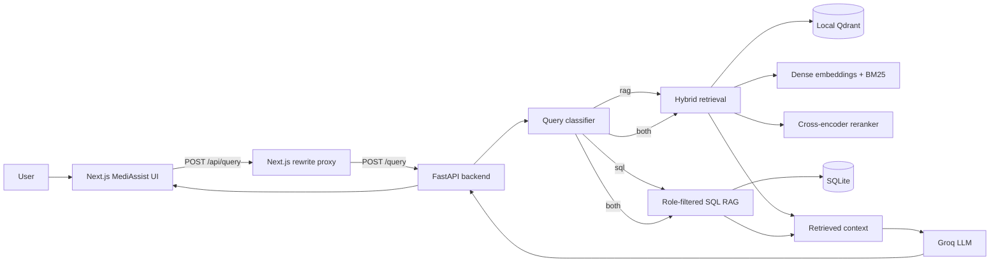
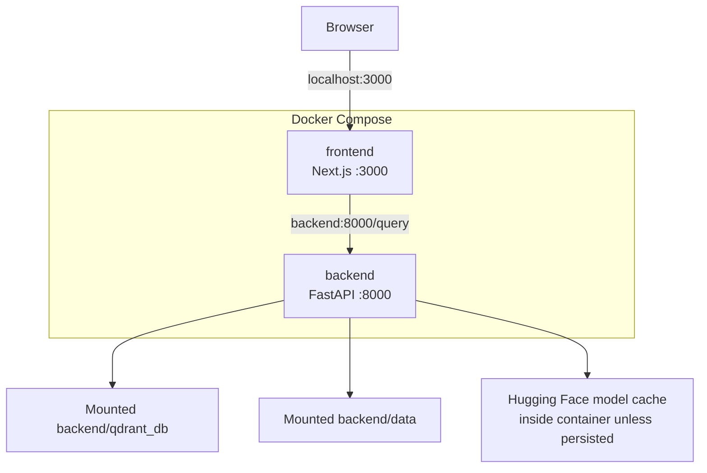
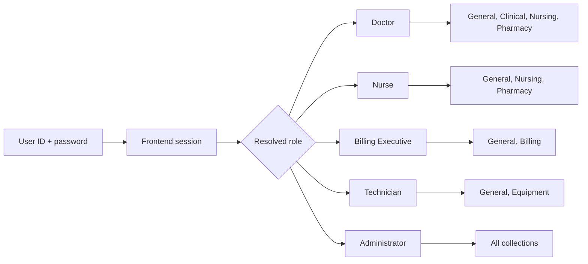
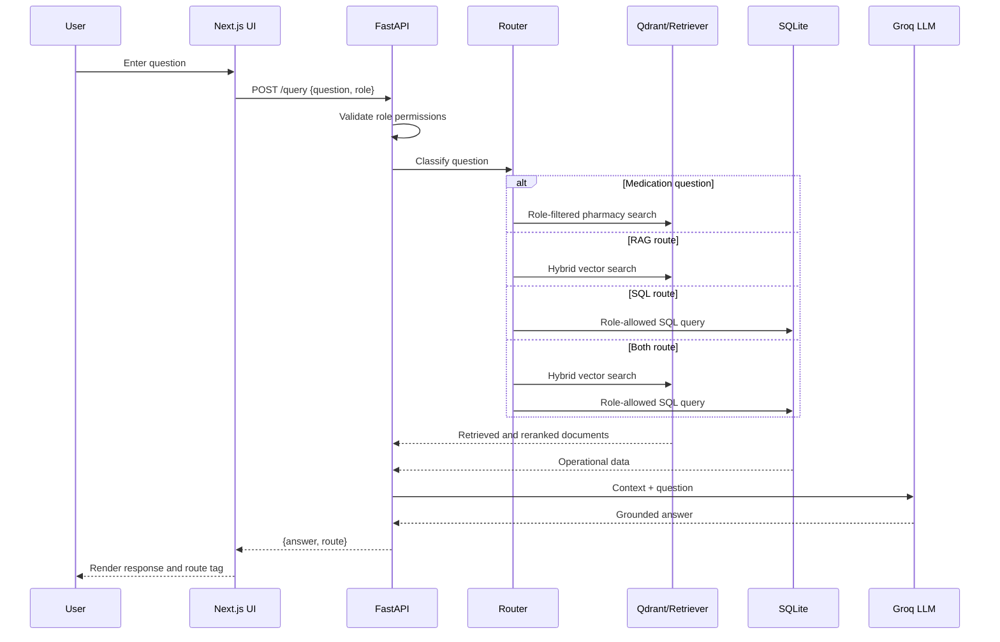
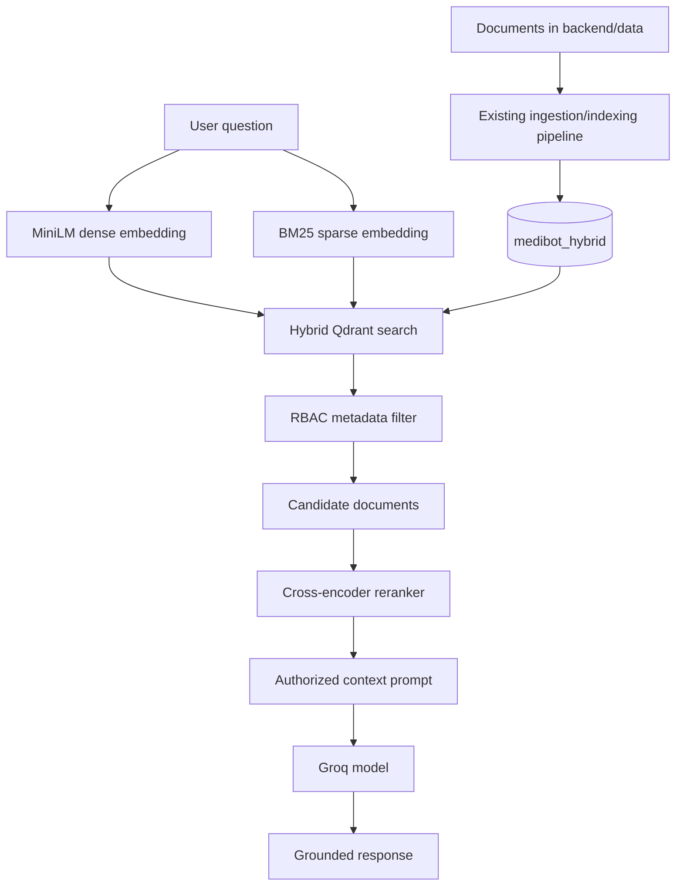

# MediAssist

MediAssist is a role-aware hospital knowledge assistant. It combines a polished Next.js chat interface with a FastAPI retrieval-augmented generation (RAG) service, local Qdrant vector storage, SQL-backed operational data, and a Groq-powered language model.

The application supports:

- Role-based sign-in and session persistence.
- Role-specific access to clinical, nursing, pharmacy, billing, equipment, and general collections.
- Hybrid dense and sparse vector retrieval through Qdrant.
- SQL/RAG/both query routing.
- Medication questions routed through a protected pharmacy-aware RAG path.
- Source-aware answers generated from retrieved document context.
- Docker Compose deployment for frontend and backend.
- Local development with `uv` and Node.js.

> **Security notice:** The current UI uses demo credentials stored in the frontend for demonstration. It is not production authentication. Replace this with a real identity provider or backend authentication before production use.

## Architecture



### Docker deployment



## Project structure

```text
MediBot/
├── main.py                    # FastAPI application and /query endpoint
├── backend/
│   ├── app/
│   │   ├── config.py          # Paths, model names, Qdrant configuration
│   │   ├── llm.py             # Groq LLM client
│   │   ├── rcba.py            # Role/collection/table permissions
│   │   ├── router.py          # Query classification and drug detection
│   │   ├── search.py          # Hybrid Qdrant retrieval
│   │   ├── reranker.py        # Cross-encoder reranking
│   │   └── sql_rag.py         # SQL-backed answers
│   ├── data/                  # SQLite database and source documents
│   └── qdrant_db/             # Local Qdrant collection
├── frontend/
│   ├── app/
│   │   ├── page.tsx           # Login and chatbot UI
│   │   ├── globals.css        # Application styling
│   │   └── layout.tsx         # Root layout and metadata
│   ├── Dockerfile
│   └── package.json
├── Dockerfile.backend
├── docker-compose.yml
├── pyproject.toml              # Python dependencies
├── uv.lock                     # Locked Python dependencies
├── .env.example
└── README.md
```

## Role-based access



The backend independently enforces permissions using:

- `ROLE_COLLECTIONS` for document collections.
- `SQL_ROLE_TABLES` for SQL data.
- Qdrant payload filters on `metadata.access_role`.
- Pharmacy access checks for medication-related questions.

### Demo accounts

All demo accounts use the password `medibot`.

| User ID | Display name | Role |
| --- | --- | --- |
| `dr.sarah` | Dr. Sarah Mitchell | Doctor |
| `nurse.emma` | Emma Rodriguez | Nurse |
| `billing.alex` | Alex Johnson | Billing Executive |
| `tech.daniel` | Daniel Kim | Technician |
| `admin` | Maya Patel | Administrator |

## Query lifecycle



## Requirements

### Docker

- Docker Desktop with Docker Compose.
- At least several GB of free disk space. The backend image contains Torch, Docling, Transformers, and related ML dependencies.
- A valid Groq API key.

### Local development

- Python 3.13 recommended.
- [`uv`](https://docs.astral.sh/uv/)
- Node.js 20 or newer.
- npm.

## Configuration

Create a root `.env` file from the template:

```powershell
Copy-Item .env.example .env
```

Set the model provider key:

```dotenv
GROQ_API_KEY=your_groq_api_key_here
```

Never commit `.env` or API keys. If a key has previously been exposed, rotate it.

Useful optional variables:

```dotenv
QDRANT_URL=http://localhost:6333
QDRANT_API_KEY=
JWT_SECRET=replace-in-production
MEDIBOT_AUTOSTART_FRONTEND=false
```

`QDRANT_URL` is only used when connecting to a Qdrant server. The default project configuration uses the local file-backed collection at `backend/qdrant_db`.

## Run with Docker Compose

Build and start both services:

```powershell
docker compose up --build
```

For subsequent starts, avoid rebuilding:

```powershell
docker compose up -d
```

Open:

- Frontend: <http://localhost:3000>
- FastAPI Swagger docs: <http://localhost:8000/docs>
- FastAPI OpenAPI schema: <http://localhost:8000/openapi.json>

Check service status and logs:

```powershell
docker compose ps
docker compose logs -f backend
docker compose logs -f frontend
```

Stop the services:

```powershell
docker compose down
```

The Compose file mounts these directories so data survives container recreation:

- `backend/data` → `/app/backend/data`
- `backend/qdrant_db` → `/app/backend/qdrant_db`

The first backend build/start can be slow because it downloads large Python and ML packages and Hugging Face model weights. Do not start multiple backend instances against the local Qdrant directory; file-backed Qdrant permits only one active client.

## Run locally with `uv`

From the project root:

```powershell
uv sync
Copy-Item .env.example .env
uv run uvicorn main:app --host 0.0.0.0 --port 8000
```

The backend automatically starts the Next.js development server when `MEDIBOT_AUTOSTART_FRONTEND=true` and the frontend dependencies are installed.

To run the frontend separately:

```powershell
Set-Location frontend
npm install
npm run dev
```

Then open <http://localhost:3000>.

To disable automatic frontend startup when running FastAPI:

```powershell
$env:MEDIBOT_AUTOSTART_FRONTEND = "false"
uv run uvicorn main:app --host 0.0.0.0 --port 8000
```

## API

### `POST /query`

Request:

```json
{
  "question": "What is paracetamol?",
  "role": "doctor"
}
```

Response:

```json
{
  "answer": "Generated answer grounded in authorized project context.",
  "route": "rag-drug"
}
```

Possible route values include:

- `rag`
- `sql`
- `both`
- `rag-drug`
- `rag-drug-denied`

Example PowerShell request:

```powershell
$body = @{
  question = "What is paracetamol?"
  role = "doctor"
} | ConvertTo-Json

Invoke-WebRequest `
  -UseBasicParsing `
  -Uri http://localhost:8000/query `
  -Method Post `
  -ContentType "application/json" `
  -Body $body
```

The frontend normally calls `/api/query`; Next.js rewrites that request to the FastAPI backend. In Docker, the rewrite target is `http://backend:8000`, while the browser uses `http://localhost:3000`.

## Frontend experience

The UI provides:

- Split-screen branded login page.
- Password visibility toggle.
- Demo credential hint.
- Session persistence in browser storage.
- Role and user profile display.
- Authorized collection cards.
- Quick-start prompts.
- Message history with timestamps.
- Loading/typing state.
- Route labels for assistant responses.
- Sign-out control.
- Responsive styling for smaller screens.

The frontend currently performs demo account lookup locally. The role is still sent to the backend, where the authorization checks are applied again.

## Retrieval and data flow



The backend uses:

- Dense embeddings: `sentence-transformers/all-MiniLM-L6-v2`
- Sparse retrieval: `Qdrant/bm25`
- Reranking: `cross-encoder/ms-marco-MiniLM-L-6-v2`
- Vector store: local Qdrant collection `medibot_hybrid`
- LLM: configured Groq model

## Troubleshooting

### Frontend says it cannot reach MediAssist

Check that the backend is running:

```powershell
docker compose ps
curl.exe http://localhost:8000/docs
```

Then inspect logs:

```powershell
docker compose logs --tail 200 backend
```

### Qdrant lock error

Local Qdrant allows one client per storage folder. Stop duplicate services before restarting:

```powershell
docker compose down
docker compose up -d
```

Do not run two Uvicorn processes against `backend/qdrant_db`.

### Docker startup is slow

The backend image is intentionally ML-heavy. The first build downloads Torch/CUDA and document-processing packages. Startup also loads embedding models. Use `docker compose up -d` after the first successful build instead of `docker compose up --build`.

### Node version error

Use Node.js 20 or newer:

```powershell
node --version
npm --version
```

Run npm commands from `frontend`, not the repository root:

```powershell
Set-Location frontend
npm install
npm run dev
```

### Missing collection

Confirm the local collection exists:

```text
backend/qdrant_db/meta.json
backend/qdrant_db/collection/medibot_hybrid/storage.sqlite
```

If these files are absent, restore or regenerate the indexed Qdrant data before starting the backend.

## Production considerations

Before production deployment:

1. Replace demo frontend authentication with server-side authentication and secure sessions.
2. Move secrets to a secret manager or protected deployment environment.
3. Rotate any previously exposed API keys.
4. Use a hosted Qdrant server for multiple backend replicas.
5. Persist Hugging Face model caches and application data.
6. Add request authentication, rate limiting, audit logging, and HTTPS.
7. Pin and regularly update dependencies, especially the frontend framework.
8. Add health checks and readiness checks that wait for model/vector-store initialization.
9. Remove or restrict Swagger documentation if it should not be public.
10. Validate that every document payload has the expected RBAC metadata.

## License

This project does not currently declare a license. Add an explicit license before distributing it.
